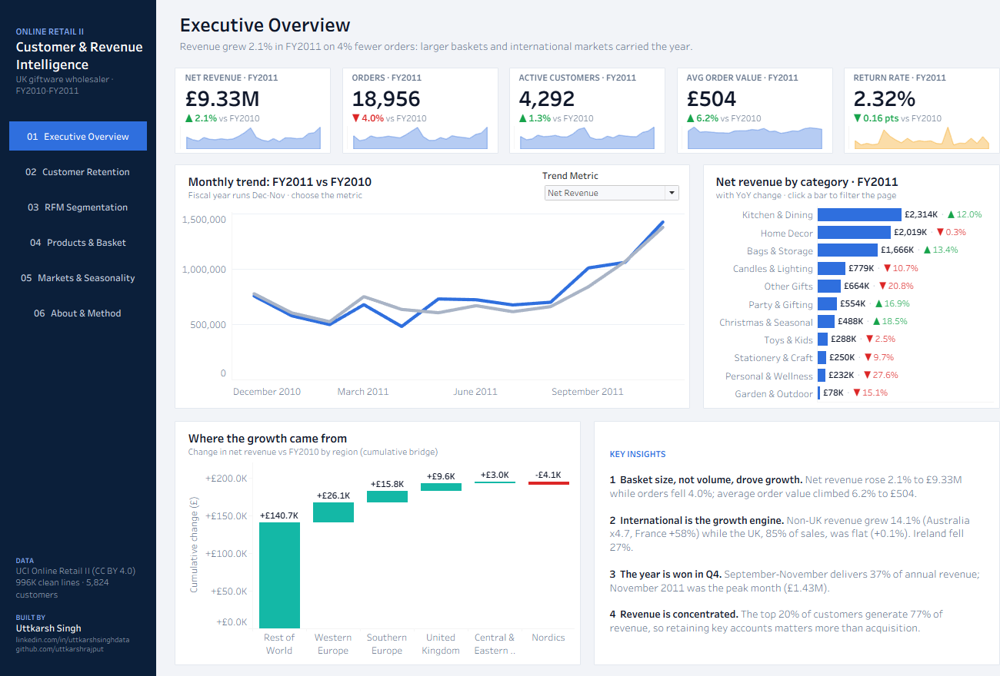
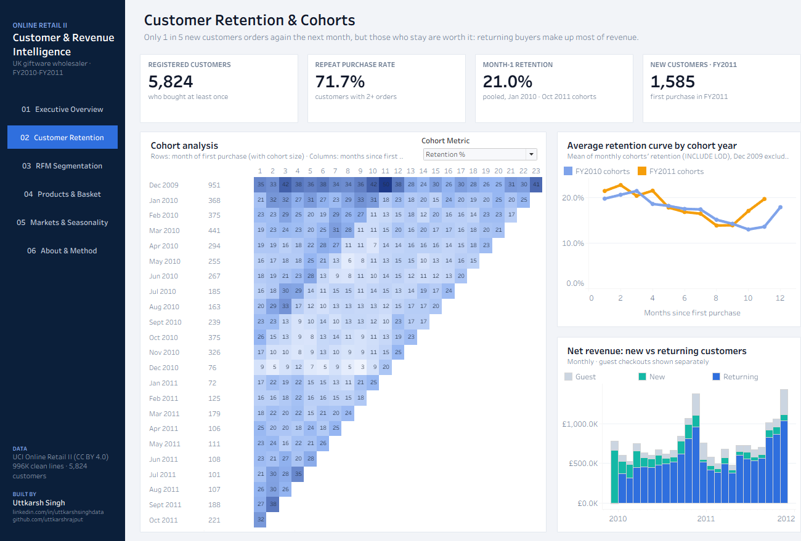
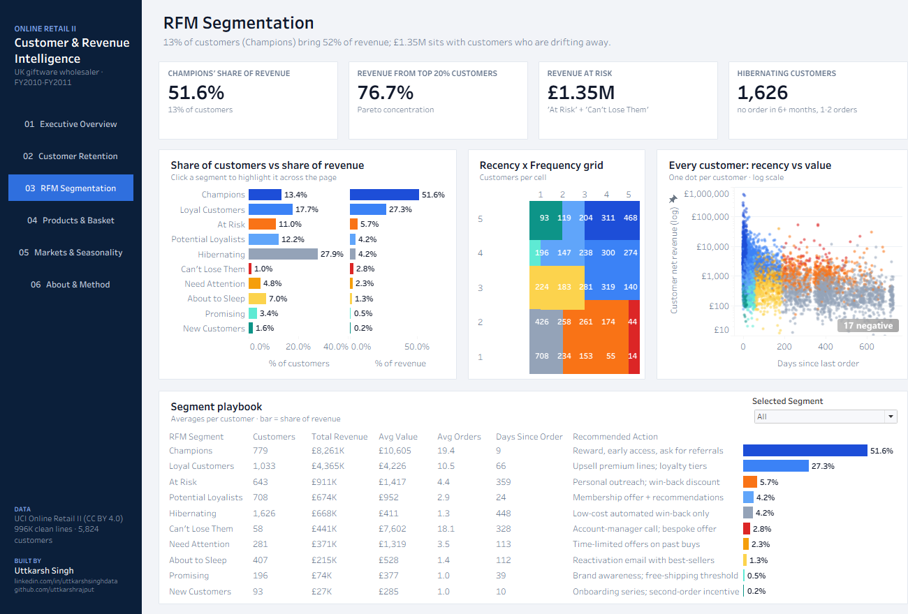
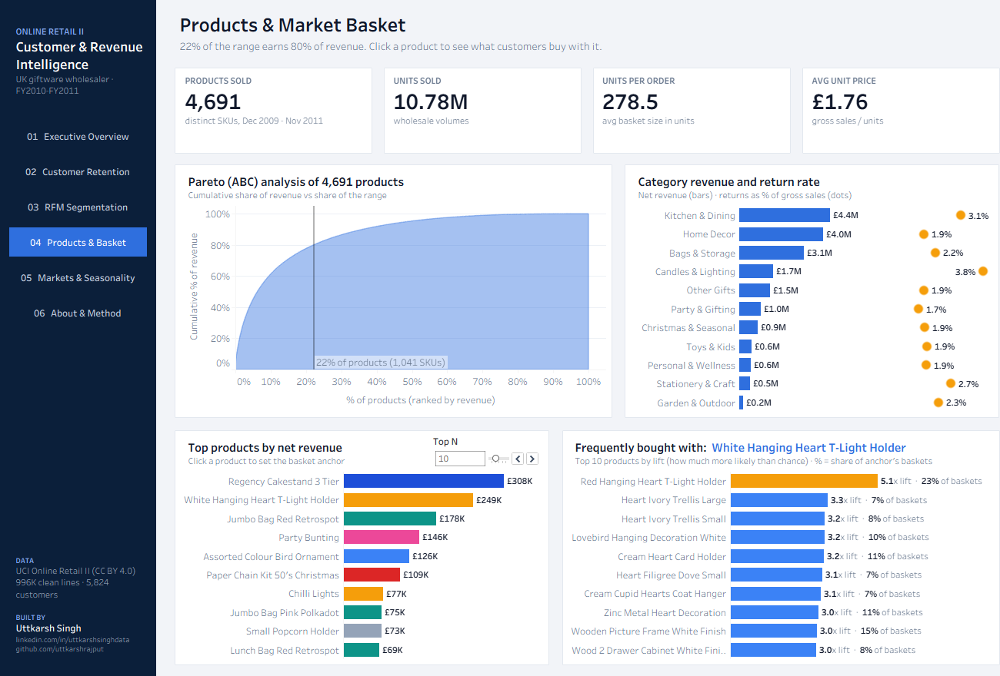
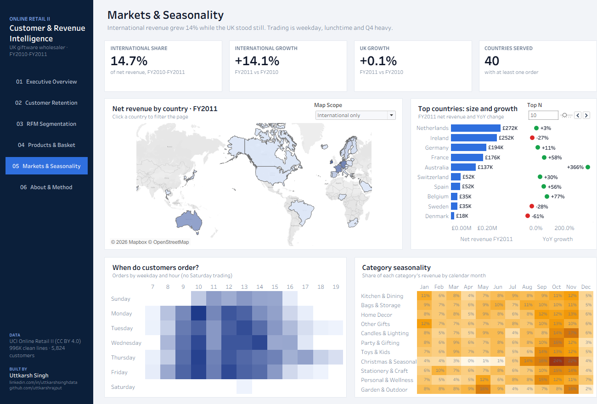

# Online Retail: Customer & Revenue Intelligence (Tableau)

An end-to-end analytics project on **1.07 million real transactions** from a UK online giftware wholesaler. Raw invoice lines are cleaned in Python, loaded into a Tableau Hyper extract and analysed in a **6-page interactive Tableau workbook**. The pages cover revenue performance, customer retention cohorts, RFM segmentation, product Pareto and market-basket analysis, and international markets.

**Live dashboard:** [view it on Tableau Public](https://public.tableau.com/app/profile/uttkarsh.singh6558/viz/OnlineRetailCustomerRevenueIntelligence/ExecutiveOverview)
**Tools:** Python (pandas, SciPy, Tableau Hyper API) · Tableau Desktop 2026.2
**Data:** [UCI Online Retail II](https://archive.ics.uci.edu/dataset/502/online+retail+ii) (CC BY 4.0), Dec 2009 - Dec 2011



---

## Business questions

1. Where did FY2011 revenue growth come from: volume, basket size, products or markets?
2. How well does the business keep the customers it acquires?
3. Which customers matter most, and which are slipping away?
4. Which products drive revenue, and what do customers buy together?
5. When and where does the business sell?

The fiscal year runs **December to November**, so FY2011 = Dec 2010 - Nov 2011.

## Key findings

| # | Finding | Evidence |
|---|---------|----------|
| 1 | **Growth came from bigger baskets, not more orders** | Net revenue +2.1% to £9.33M while orders fell 4.0%; average order value rose 6.2% to £504 |
| 2 | **International markets are the growth engine** | Non-UK revenue +14.1% (Australia x4.7, France +58%) vs UK +0.1%; Ireland, the largest export market over the two years, fell 27% |
| 3 | **Revenue is highly concentrated** | Top 20% of customers = 76.7% of revenue; "Champions" are 13% of customers but 51.6% of revenue |
| 4 | **Retention is the main lever** | Only ~21% of new customers buy again the following month; £1.35M of revenue sits with "At Risk" and "Can't Lose Them" customers |
| 5 | **A short head of products earns most of the money** | 22% of the range (1,041 of 4,691 SKUs) generates 80% of revenue |
| 6 | **Q4 decides the year** | September-November = 37% of annual revenue; trading is weekday, 10:00-15:00, with almost no Saturday orders |

## Dashboards

| Page | What it shows | Key techniques |
|------|---------------|----------------|
| **Executive Overview** | KPI cards with YoY and sparklines, FY-vs-FY monthly trend, category revenue, region revenue bridge, written insights | CY/PY logic with a `{FIXED}` latest-year LOD, metric-switch parameter, Gantt-bar waterfall (running total), filter action |
| **Customer Retention** | Cohort heatmap (retention % or revenue per customer), average retention curves, new vs returning revenue | `{FIXED}` first-purchase cohorts, `INCLUDE` LOD cohort averages, **dynamic zone visibility** |
| **RFM Segmentation** | Customer vs revenue share by segment, R x F grid, per-customer scatter (log scale), segment playbook | Nested LOD quintiles over **one row per customer**, 10-segment RFM model, parameter actions for cross-chart highlighting |
| **Products & Basket** | ABC/Pareto curve, category revenue vs return rate, top-N products, "frequently bought with" | Running-total table calcs, `RANK_UNIQUE` top-N filter, dual-axis bar + dot, market-basket lift with a click-to-set anchor product |
| **Markets & Seasonality** | Filled map, top countries with YoY, weekday x hour heatmap, category seasonality | Geographic roles, map-scope parameter, percent-of-total table calc across months, filter actions |
| **About & Method** | Business question, data preparation, techniques, data-cleaning funnel | Data-quality audit trail as a chart |

<p float="left">
  
  
  
  
</p>

## Data preparation (Python)

| Step | Rows | Removed | Why |
|------|-----:|--------:|-----|
| Raw source lines (2 Excel sheets) | 1,067,371 | | |
| Remove sheet overlap (1-9 Dec 2010) | 1,044,848 | 22,523 | The same 9 days appear in both yearly sheets |
| Drop partial month (1-9 Dec 2011) | 1,019,322 | 25,526 | Keeps two complete Dec-Nov fiscal years for fair YoY |
| Drop exact duplicate lines | 1,007,789 | 11,533 | Double-scanned invoice lines |
| Keep product sales and returns only | 996,132 | 11,657 | Postage, fees, bad-debt adjustments, zero-price lines, stock write-offs and 20 reversed order-entry errors (e.g. a 74,215-unit order cancelled 16 minutes later) |

Also in the pipeline:
- Each line is classified as Sale or Return; net revenue = sales net of returns.
- One canonical product name per stock code.
- 11 rule-based product categories.
- Country names standardised and mapped to regions.
- Customers without an ID are kept for revenue but excluded from customer analytics.
- Market-basket **support, confidence and lift** are computed for 58,710 product pairs across 38,698 orders, using a sparse co-occurrence matrix.

```
data_prep/
  00_download.py          download the UCI zip
  01_load_raw.py          both Excel sheets -> one parquet file
  02_clean.py             cleaning rules + categories + cleaning log
  03_market_basket.py     product-pair support / confidence / lift
  04_build_hyper.py       tables -> Tableau Hyper extract
  05_validate_numbers.py  independent pandas calculation of every headline number
```

## Validation

Every headline figure on the dashboards was checked against an independent pandas calculation (`data/expected.json`):

| Metric | pandas | Tableau |
|--------|-------:|--------:|
| Net revenue FY2011 | £9,331,199 | £9.33M |
| Net revenue YoY | +2.09% | +2.1% |
| Orders FY2011 | 18,956 | 18,956 |
| Average order value FY2011 | £503.97 | £504 |
| Return rate FY2011 | 2.32% | 2.32% |
| Registered customers | 5,824 | 5,824 |
| Repeat purchase rate | 71.7% | 71.7% |
| Champions (customers / revenue) | 779 / £8,260,952 | 779 / £8,261K |
| Hibernating customers | 1,626 | 1,626 |
| International YoY | +14.1% | +14.1% |

## How to open or rebuild

- **Just explore:** open `Online Retail Customer Intelligence.twbx` in Tableau Desktop or Tableau Public (the extract is packaged inside).
- **Rebuild the data:**
  ```bash
  pip install -r requirements.txt
  python data_prep/00_download.py && python data_prep/01_load_raw.py && python data_prep/02_clean.py
  python data_prep/03_market_basket.py && python data_prep/04_build_hyper.py && python data_prep/05_validate_numbers.py
  ```

## Author

**Uttkarsh Singh**, Data Analyst
[LinkedIn](https://www.linkedin.com/in/uttkarshsinghdata) · [GitHub](https://github.com/uttkarshrajput)

Dataset: Chen, D. (2012). Online Retail II. UCI Machine Learning Repository. Licensed CC BY 4.0.
